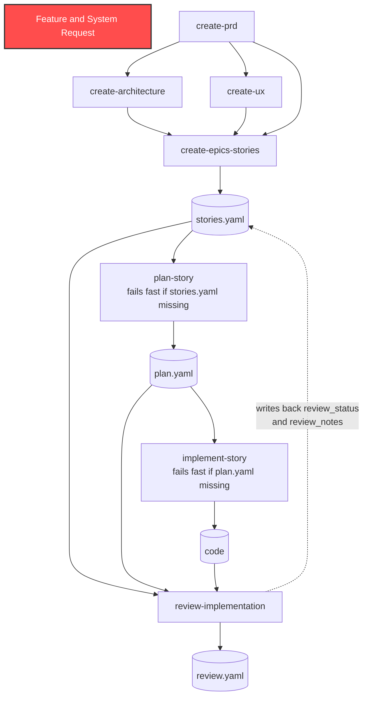

# AI Bootcamp — Week 2: Software Development Workflow

---

## Timing

- **Monday–Friday:** 9:00 AM – 5:00 PM with 1-hour lunch (7 hours each day)

---

## Objectives

By end of Week 2, the candidate can:

- Apply the EDD discipline to a domain with right/wrong answers: software development artifacts
- Build out the DLP student-workspace skeleton skills through EC-first iteration, adding Context and Constraints that are demonstrably load-bearing
- Explain the pipeline's YAML file contracts: what each skill reads and writes, the fail-fast behavior on missing inputs, and the review write-back loop
- Direct the AI to write a Python evaluation script against their EC (deterministic checks first, LLM judge second) and run baseline + iteration cycles with it
- Trace quality degradation through a multi-stage pipeline and isolate the source
- Produce an evaluation-measured iteration history showing net improvement across at least one full skill

---

## The Week 2 Pipeline

This week candidates work in the **DLP student workspace** (`../AI-Deep-Learning-Program/student-workspace/`), building out the same seven skeleton skills they will later coach client teams through in DLP Sessions 1–3. Learning these exact artifacts is the point: a bootcamp graduate should never see a skill in a client session that they have not already iterated themselves.

The workflow follows the software development lifecycle, with skills communicating through structured YAML files:

**Participants do not write these skills from scratch.** The workspace's `skills/` directory contains all seven as RT-only skeletons (Role and Task defined, Context and Constraints intentionally empty). The output of running these skeletons against a feature request is the Red state: the failures that drive the week's work. The gaps are the lesson.

Workspace orientation (from `../AI-Deep-Learning-Program/student-workspace/`):

- `skills/`: the seven RT-only skeleton skills, each with YAML frontmatter (`name`, `description`, `disable-model-invocation: true`) and an explicit File Contract (Reads / Writes / Consumed-by)
- `demo-outputs/`: pre-generated PRD, Architecture, and UX outputs from the RT-only stubs, built on the Pantry Tracker PWA sample feature. Intentionally generic; the gaps are the lesson
- `sample-stories/`: the three-way story set: `pantry-inventory.md` and `shopping-list.md` (good: testable Given/When/Then AC, edge cases, no implementation detail), `vague-pantry-stories.md` (plausible but untestable), `ai-generated-pantry-stories.md` (polished but careless: AC prescribing PostgreSQL/JWT/Redux, oversized epics, missing edge cases)
- `schemas/README.md`: the full YAML schema definitions and validation rules for `stories.yaml`, `plan.yaml`, and `review.yaml`
- `evaluations/`: where candidates commit their Python evaluation scripts

**Product descriptions** (the Feature and System Requests that drive the pipeline) are provided by the instructor. Participants are not expected to invent them.

---

## Monday (9:00 AM – 5:00 PM): Pipeline Orientation and Baseline Run

### 9:00 – 10:30 AM: The SDLC Pipeline and Its File Contracts

Walk through the full workflow diagram. For each skill: what is the input, what is the output, and who (in a real engagement) is responsible for the quality of each step?

**The YAML contracts are new this week and matter.** The pipeline is not prompts passing prose to each other. Each skill writes a structured file the next skill reads:

- `create-epics-stories` writes `stories.yaml`
- `plan-story` reads `stories.yaml` and **fails immediately with a clear error if it is missing** (no stories, no plans), then writes `plan.yaml`
- `implement-story` reads `plan.yaml` (same fail-fast contract) and produces code
- `review-implementation` reads `stories.yaml` + `plan.yaml` + the code, writes `review.yaml`, and **updates `stories.yaml`** with `review_status` and `review_notes`

That last one is the literal feedback loop: stories flow forward through the pipeline, review flows back to update the original artifact.

Key discussion: the skeleton skills are not broken; they will produce output. The question is: what assumptions does the model make when Context and Constraints are absent? Those assumptions are the failure modes you will spend this week eliminating. The demo outputs in `demo-outputs/` show exactly what RT-only stubs produce: fluent, plausible, generic.

### 10:30 AM – 12:00 PM: First Pipeline Run: Observe, Don't Fix

Clone the student workspace. Run all seven skills in sequence against a provided product description. Do not change any skill yet. Just run and observe.

For each output, note:

- What assumptions did the model make that were not in the skill?
- What did the model do that you did not ask it to do?
- What did the model fail to do that a human expert would have done automatically?

Record these observations. They are the raw material for your Evaluation Criteria.

### 12:00 – 1:00 PM: Lunch

### 1:00 – 2:30 PM: The Three-Way Quality Bar and Writing EC

Before writing any EC, run the contrast exercise. Read the three story sets in `sample-stories/` side by side:

- **Good** (`pantry-inventory.md`): what specific, testable AC look like
- **Vague** (`vague-pantry-stories.md`): plausible-sounding, untestable, no edge cases
- **AI-generated without care** (`ai-generated-pantry-stories.md`): polished, confident, and wrong in a specific way: AC that prescribe implementation (PostgreSQL, JWT, Redux), epics too large, edge cases missing

Discussion: what makes the third set dangerous is that it *looks* better than the first. Fluency is not quality. This is why EC are written before building and why they must be measurable.

Now write EC for `create-prd` and `create-architecture`, by hand, before touching any skill. Use the failure observations from the morning run as input; those observed failures should appear as explicit failure criteria.

**For `create-prd`:** Define at least 4 EC, including at minimum:

- Required sections (what must be present in every PRD regardless of input)
- A criterion about specificity (the PRD should not use vague language like "easy to use" or "fast" without measurable definitions)
- A criterion about scope boundaries (what the PRD must explicitly exclude as out-of-scope)

**For `create-architecture`:** Define at least 4 EC. Consider what a solutions architect would always include that the model might omit without being told.

**Reminder on vocabulary:** these are Evaluation Criteria (EC), the quality bar for the skill's output. Acceptance Criteria (AC) are the product artifact that `create-epics-stories` produces. Never "success criteria."

### 2:30 – 5:00 PM: Baseline Evaluation for create-prd

Direct the AI to write a Python evaluation script for `create-prd` against your EC. You write the EC; the AI writes the code. Read the script before running it.

**Deterministic first, LLM judge second:**

- Deterministic checks (no model call: schema validation, section presence, field counts, format patterns) cover every EC that can be expressed as code
- LLM judge checks (send the skill output + the EC to a model, get a structured JSON verdict with per-criterion pass/fail and reasoning) only for EC that genuinely require judgment

If you find yourself reaching for an LLM judge for something that could be a regex, the EC needs refinement.

Run the baseline against the RT-only skeleton. Record scores. This is your Red state for Day 2. Commit the script to `evaluations/`.

---

## Tuesday (9:00 AM – 5:00 PM): Create PRD: Full EDD Iteration

### 9:00 – 10:00 AM: Hypothesis Formation

Review yesterday's baseline results for `create-prd`. For every failing check, form a specific hypothesis: *"This criterion fails because the skill does not specify X. I predict that adding X as a Constraint will cause this check to pass."*

Write the hypotheses before opening the skill file.

### 10:00 AM – 12:00 PM: Context First, Then Constraints

**Sequence matters.** Start by adding Context to the skill: the WHY. The intent behind the PRD, who it serves, what decisions it exists to drive. Run the evaluation script. Record the delta.

Then add Constraints: the HOW. The data, rules, required sections, and never-dos the output must follow. Run the evaluation again.

This two-phase approach teaches candidates to distinguish "the model needs to understand the intent" from "the model needs more rules." These are different failure modes with different fixes. A useful diagnostic during the load-bearing audit: is this instruction in the right RTCC section? Intent language sitting in Constraints is a smell.

### 12:00 – 1:00 PM: Lunch

### 1:00 – 3:30 PM: Iterate to Green

Continue EDD iteration on `create-prd`. Minimum: 4 total evaluation runs (baseline + 3 iterations) with a documented hypothesis for each change. One change per iteration.

After achieving Green (all checks passing): perform the load-bearing audit. Remove each instruction one at a time. If no check fails, the instruction is dead weight.

### 3:30 – 5:00 PM: Write EC and Baseline for Architecture

Apply the same discipline to `create-architecture`: write EC by hand, direct the AI to extend or write the evaluation script, run the baseline.

---

## Wednesday (9:00 AM – 5:00 PM): Create Architecture and Create UX

### 9:00 AM – 12:00 PM: Create Architecture: Full EDD Iteration

Full EDD cycle for `create-architecture`. Minimum: 4 evaluation runs with documented hypotheses. Load-bearing audit at the end.

**Specific challenge for Architecture:** Some of what belongs in an architecture document depends heavily on Context: the technology stack, the existing system, the team's conventions. Add Context that makes the Architecture skill produce different output for different stack descriptions. The test that this Context is load-bearing: run the skill with and without it; the outputs should be meaningfully different.

### 12:00 – 1:00 PM: Lunch

### 1:00 – 3:00 PM: Create UX: EDD

Write EC for `create-ux`. Build and iterate with the evaluation script.

**Specific challenge for UX:** The model's default UX output tends to be generic. The Context needed is often about intent: who the users are and what the experience should accomplish. Constraints should specify the format of UX specs (personas, flows with decision points and error risks, interactions, error states). Test that both are load-bearing.

### 3:00 – 5:00 PM: Upstream Quality Test

Run the improved PRD through Architecture and UX. Compare to Monday's baseline output from the same PRD. Document the quality delta. Identify whether remaining weaknesses are in the upstream skills (PRD quality) or the downstream skills (Architecture/UX quality).

---

## Thursday (9:00 AM – 5:00 PM): Create Epics & Stories and Plan Story

### 9:00 – 10:30 AM: Write EC for Epics & Stories and Plan Story

`create-epics-stories` takes three upstream outputs as input (PRD + Architecture + UX) and writes `stories.yaml`. Before writing EC, consider: what are the most common ways story decomposition fails?

- Stories that are too large to implement in a sprint
- Acceptance Criteria that are not testable
- Stories that omit dependencies
- Stories that duplicate work described in other stories
- AC that prescribe implementation detail (remember the AI-generated sample stories)

Define EC that catch these specific failure modes. Note that the schema gives you free deterministic checks: 3–8 AC per story, at least one negative or edge_case AC per story, unique story IDs. Those run without any model call.

### 10:30 AM – 12:00 PM: Create Epics & Stories: Build and Iterate

EDD cycle for `create-epics-stories`. Because this skill takes rich upstream context as input, its Context section should describe the intent: how to interpret and prioritize information from the three upstream documents when they conflict or are incomplete.

### 12:00 – 1:00 PM: Lunch

### 1:00 – 3:00 PM: Plan Story: Build and Iterate

EDD cycle for `plan-story`.

**The plan quality dependency, named explicitly:** code is generated from the plan, never directly from the story. A vague plan produces vague code; a specific plan produces specific code. This is why `plan-story` fails fast if `stories.yaml` is missing, and why its schema requires every AC to be referenced by at least one task's `acceptance_criteria_refs`.

This skill is often where candidates first encounter the challenge of injecting technical specificity: a plan for a Node.js API looks different from a plan for a Python service. Context must carry the intent and the environment. Test that it is load-bearing by running the same story through the skill with two different stack descriptions; the plans should differ in ways that are specific to the stack.

### 3:00 – 5:00 PM: Three-Stage Pipeline Check

Run a feature request through PRD → Architecture → UX → Epics & Stories → Plan Story. Review the `plan.yaml` output against the original feature request. Trace any quality gaps back to their source. Check the schema contract held: every AC referenced, tasks in dependency order.

---

## Friday (9:00 AM – 5:00 PM): Implement Story, Review Implementation, and Week 2 Synthesis

### 9:00 – 11:00 AM: Implement Story and Review Implementation: EDD Cycles

Apply EDD to both remaining skills. Note that `implement-story` and `review-implementation` are the most context-heavy skills in the pipeline; the quality of their output depends almost entirely on how well the prior skills have defined the story, the AC, and the plan.

Key insight to surface: if implementation quality is low, adding more Constraints to `implement-story` often helps less than improving the quality of `plan-story` output that feeds into it.

**The review feedback loop:** `review-implementation` does not just produce `review.yaml`. It writes the verdict (`passed`, `failed`, `changes_requested`) and review notes back into `stories.yaml`, so the story carries its own review state. Stories flow forward; review flows back. Run a review and verify the write-back happened.

### 11:00 AM – 12:00 PM: Full Pipeline Run

Run a complete pipeline from a new, unseen product description (instructor provides a second description). Run all seven skills in sequence. Do not change any skill during this run; this is a test of whether your improvements generalize to a new input.

### 12:00 – 1:00 PM: Lunch

### 1:00 – 3:00 PM: Week 2 Synthesis: Comparison and Load-Bearing Audit

Compare your Week 2 Day 5 pipeline output to your Week 2 Day 1 baseline output on the same product description.

For each skill: how many Constraints did you add that are genuinely load-bearing? How many instructions did the load-bearing audit remove? What did the evaluation scores show across iterations? Where did deterministic checks suffice, and where did you genuinely need the LLM judge?

### 3:00 – 5:00 PM: Reflection and Artifacts Review

**Week 2 Artifacts Review:**

- [ ] All 7 skill files committed with completed Context and Constraints sections
- [ ] Hand-written EC for at least `create-prd` and `create-architecture`, written before the skills were touched
- [ ] Python evaluation scripts committed to `evaluations/`, with baseline + iteration results for all 7 skills
- [ ] Load-bearing audit documentation for at least 3 skills
- [ ] Upstream quality dependency notes: at least one documented case where a downstream failure traced back to an upstream skill
- [ ] One complete pipeline run with `stories.yaml`, `plan.yaml`, and `review.yaml` committed, including the review write-back to `stories.yaml`

---

## Week 2 Deliverables (committed to repo)

- [ ] All 7 skeleton skill files built out (Context and Constraints complete, all instructions load-bearing)
- [ ] Python evaluation scripts with baseline + iteration results for all 7 skills (deterministic checks plus LLM judge where judgment is required)
- [ ] Load-bearing audit notes for at least 3 skills
- [ ] Side-by-side comparison: Day 1 baseline output vs. Day 5 output for the same product description
- [ ] Upstream dependency trace: at least one documented quality failure traced to its source skill
- [ ] Pipeline artifacts from one full run: `stories.yaml`, `plan.yaml`, `review.yaml`, with the review write-back visible in `stories.yaml`

---

## Coaching Notes for Instructors

**Common failure modes:**

- **Candidates let the AI write the EC, not just the evaluation script**: this inverts EDD. The candidate defines what success looks like, by hand, before building; the AI only writes the code that measures it. An AI-written EC tests whether the model produces what the model would produce anyway, which tells you nothing.
- **Candidates reach for the LLM judge for everything**: deterministic first, LLM judge second. Schema rules from `schemas/README.md` (AC counts, unique IDs, dependency order, every AC referenced) are free deterministic checks. If a candidate is using an LLM judge for something a regex could catch, their EC needs refinement.
- **Candidates add long Context sections that are mostly background noise**: Context is the WHY, the intent. Push them to test that Context is load-bearing the same way they test Constraints: run the skill with and without it; if the output is not meaningfully different, it is not doing work.
- **Candidates try to fix downstream quality by adding more instructions to the downstream skill**: "if my code quality is bad, I'll add more Constraints to implement-story" often does not work. Code is bad because plans are vague, and plans are vague because stories are weak. Train candidates to trace failures upstream. The plan quality dependency is the canonical example: code is generated from the plan, never directly from the story.
- **Candidates run the skills without reading the output carefully**: evaluation scores are useful but not sufficient. Candidates should be reading and evaluating the actual outputs, not just watching scores.
- **Product descriptions that are too simple make Constraints unnecessary**: use product descriptions with ambiguity: competing requirements, multiple user types, unclear technical context. Ambiguity is what makes Context and Constraints load-bearing.
- **Candidates rush to Green and skip the load-bearing audit**: passing all checks on an evaluation that was designed to be easy is not DLP Completion. The audit matters. Enforce it.
