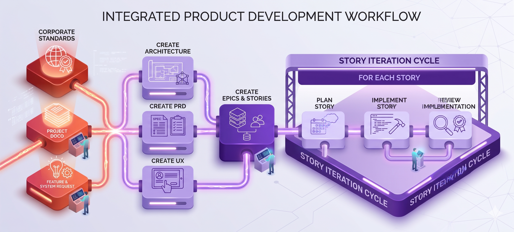

# SDLC Skeleton Skills — Overview

*Introduced in Session 1. Iterated by participants through Sessions 1-3 using EDD discipline.*

---

## Purpose

These are **RT-only starter skills** — Role and Task only, with no Context or Constraints — that participants are introduced to in Session 1.

Each skill file uses `.skill.md` format with YAML frontmatter (`disable-model-invocation: true`). They are not auto-invoked by the model; they are run explicitly by participants to produce baseline output.

They serve a specific pedagogical purpose: when participants run these skills against real work, the output will be incomplete or wrong because the Context and Constraints fields are empty. That failure is the lesson. Participants then spend Sessions 1-3 applying EDD discipline — writing evaluation criteria, running baselines, and iterating — to add Context and then Constraints until each skill's load-bearing rules are documented.

**Do not add Context or Constraints to these files.** They are teaching artifacts, not production-ready skills. The participants' own iterated versions — with their team's specific context and constraints filled in — are the real deliverables.

---

## The Seven Skills

| File | SDLC Stage | Built Out In |
|------|------------|--------------|
| [create-prd.skill.md](create-prd.skill.md) | Product requirements | Session 1 (demo) |
| [create-architecture.skill.md](create-architecture.skill.md) | System architecture | Session 1 (demo) |
| [create-ux.skill.md](create-ux.skill.md) | UX design guidance | Session 1 (demo) |
| [create-epics-stories.skill.md](create-epics-stories.skill.md) | Epics and stories breakdown | Session 1 |
| [plan-story.skill.md](plan-story.skill.md) | Story planning and task decomposition | Session 2 |
| [implement-story.skill.md](implement-story.skill.md) | Story implementation guidance | Session 2 |
| [review-implementation.skill.md](review-implementation.skill.md) | Implementation review | Session 3 |

## Demo Outputs

Pre-generated demo outputs for the first three skills show what RT-only stubs produce when run against a realistic feature ("Pantry Tracker PWA"):

- [demo-prd-output.md](demo-prd-output.md) — output of `create-prd` run RT-only
- [demo-architecture-output.md](demo-architecture-output.md) — output of `create-architecture` run RT-only
- [demo-ux-output.md](demo-ux-output.md) — output of `create-ux` run RT-only

These demos make the full pipeline visible in Session 1. The gaps in them (missing domain detail, wrong assumptions, generic patterns) are the lesson: participants see what is missing and understand WHY they need to add Context and Constraints.

---

## Session Roadmap

### Session 1 — Introduction & Epics/Stories
Participants are introduced to the 7 SDLC skills, run the demo outputs, and see the full pipeline. The `create-epics-stories` skill is built out with full Context and Constraints during this session.

### Session 2 — The Development Loop
Participants build out the `plan-story` and `implement-story` skills. These two skills form the core development loop: plan a story, implement it, then plan the next.

### Session 3 — Review & Iterate
Participants build out the `review-implementation` skill, completing the full SDLC pipeline. By the end of Session 3, all seven skills have been iterated with EDD discipline.

---

## How to Use These in Session 1

Participants walk through the pipeline in order:

1. Review the demo output of `create-prd.skill.md` (pre-generated)
2. Review the demo output of `create-architecture.skill.md` (pre-generated)
3. Review the demo output of `create-ux.skill.md` (pre-generated)
4. Run `create-epics-stories.skill.md` on a real, in-flight feature
5. Continue through the pipeline to `review-implementation.skill.md`

At each step, participants observe what the RT-only skill produces — and what is clearly missing. By the end of the walkthrough, participants understand concretely why Context and Constraints are load-bearing.

---

## EDD Iteration Expectation

By the end of Sessions 1-3, participants should have at least one skill from this set with:
- 4–6 written evaluation criteria (written before the first Python evaluation run)
- A Python evaluation baseline run documented
- At least one iteration cycle: hypothesis → result → conclusion
- All remaining instructions passing the load-bearing test